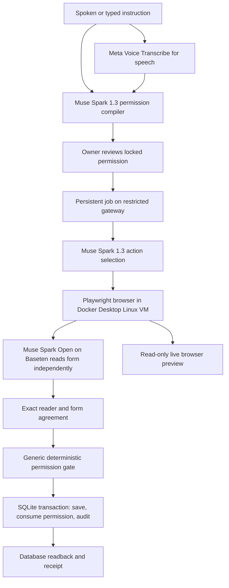

# Iris architecture and delivery order

Updated 29 October 2026. Iris is a permission enforced on a write, demonstrated across two owned applications.

The reader receives only the captured form, never the sentence, permission, or planner answer. Its agreement is evidence about the form, not authorization. The gate alone checks authorization inside the persistence transaction. The current reader examines structured form data; it is not yet a separate visual extraction from a screenshot. Correlated capture errors remain an evaluation concern.

## Engineering properties already implemented

- One resource-independent gate for booking and order writes, with strict JSON type/value comparisons.
- SQLite `BEGIN IMMEDIATE` serializes permission consumption and record updates; two simultaneous exact submissions cannot save twice.
- Optimistic concurrency through record versions; stale authorization is invalidated.
- Single-use permissions and owner stop/revocation. A failed or disagreeing reader pauses and revokes authorization.
- Capability separation: owner API creates permissions; worker gateway cannot create them. Browser cannot access the owner API, public internet, host mounts, Docker socket, or either provider key.
- Durable job records, write receipts, and separate reader evidence with provider/model/outcome/delay.
- Separate Meta and Baseten budget ledgers; atomic reservations before calls, capped outputs, no automatic model retries, conservative reservations on uncertain failures.
- Explicit provider selection; a Baseten failure never silently switches to Meta.

The desktop is a container inside Docker Desktop's Linux VM, not a new VirtualBox machine per task. Closing the owner page does not stop it. Docker and the computer must stay running.

## Remaining work, in order

1. **Completed 29 October:** Open reader verified in actual booking and order browser runs; evidence retained under `docs/evidence/baseten-*.json`. These are development checks, not held-out results.
2. **Completed 29 October:** worker session leases, independent heartbeats, expiry/revocation, atomic job receipts, and a live container-interruption trial. Recovery reconciles saved receipts without replaying writes.
3. **Implemented and exercised 29 October:** recording-start snapshots and the full AudioWorklet, Meta transcription, permission, browser, and receipt pipeline using labeled synthesized microphone input. A human microphone recording is still required for the film.
4. Run labeled adversarial browser trials: wrong person, price mutation, stale record, ambiguous instruction, and stopped/in-flight saves.
5. Freeze held-out tasks and compare agent alone, a button-only reviewer, and Iris. Report unauthorized saves, legitimate completion, false blocks, and delay. No superiority claim before measurement.
6. Evaluate Cal.diy interception against its actual transaction path. Keep Iris-owned desks if that boundary cannot be enforced within the submission window; disclose this clearly.
7. Polish cursor, restrained activity glow, readability, and recovery messaging after agent correctness. The pointer must follow real actions; no prerecorded movement or invented reasoning.
8. Record the coffee run and store-order beat, produce the three-minute video and key-free playback, and complete submission materials ahead of 4 November India time.

FastAPI, SQLite, Playwright, and Docker already provide the required open-source foundations. Extra agent frameworks would not by themselves improve the write guarantee. Add dependencies only for a demonstrated integration or evaluation need.
